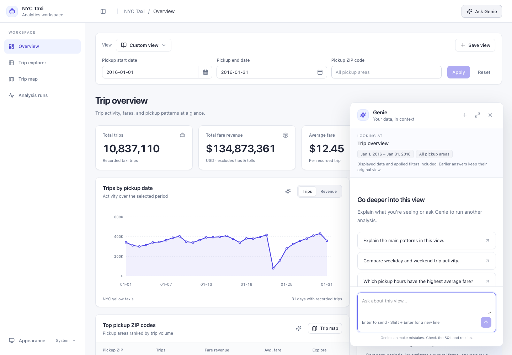

# Databricks Apps + Effect

**SQL analytics, contextual Genie, and Lakebase persistence in a TypeScript app.**

Build a data application with Effect and Foldkit on Databricks Apps. This example
is a NYC taxi explorer: filter trips, inspect a map, ask Genie about the results,
and save findings for your team.

[Deploy the example](DEPLOYMENT.md) ·
[Use your own data](#use-your-own-data) ·
[Reuse the SQL adapter](packages/sql-databricks/README.md)



_Interface preview with test data._

## What the example demonstrates

The app connects exploration, questions, and shared work in one workflow:

- **Explore warehouse data.** Filter and sort trips, inspect charts and H3 maps,
  and export the current page as CSV. Databricks SQL handles filtering, sorting,
  and pagination.
- **Ask questions in context.** Genie uses the applied filters and context from
  the current chart, trip page, or selected map area. You can inspect the
  generated SQL and continue the conversation as you move through the app.
- **Keep findings and discussions.** Save a filtered view with a finding, or
  comment on an individual trip. Lakebase provides PostgreSQL transactions for
  those writes while the analytical tables remain read-only.

The demo uses historical NYC taxi records from Databricks sample volumes.
Genie queries the same trip table as the charts and explorer.
[Data and asset sources](client/public/SOURCES.md) describe the sample.

## Why Effect and Foldkit

Effect manages query deadlines, interruption, credential refresh, and database
connections. The server and browser share an [HTTP contract](shared/api.ts) and
[domain schemas](shared/domain.ts), keeping API types and runtime validation in
one definition.

The frontend uses Foldkit to keep [features](client/src/features) independent
and testable. [Foldkit UI](https://foldkit.dev/ui/overview)
provides keyboard and interaction behavior. Tailwind and the
[visual helpers](client/src/ui) provide the styling.

The reusable [Databricks SQL adapter](packages/sql-databricks/README.md) connects
Effect SQL to the Statement Execution API. It supports parameterized queries,
ordinary row results, and columnar Arrow results, so the same service can serve
application queries and Arrow consumers.

## Run the example

Start with the [deployment guide](DEPLOYMENT.md). It covers
workspace requirements, resource names, and adoption of an existing warehouse
or app. Setup deploys the services, prepares the sample data, and writes the
local connection settings to `.env`.

After setup, start the local development server:

```sh
npm run dev
```

By default, local development uses your existing Databricks CLI login, and the
deployed app uses its service principal's OAuth credentials. Explicit credentials
in environment variables override these defaults. The standalone SQL adapter uses
credentials supplied by its caller.

## Use your own data

Keep the application structure and replace the taxi-specific parts:

| Change                                             | Start here                                                                     |
| -------------------------------------------------- | ------------------------------------------------------------------------------ |
| Source data and analytical queries                 | [Ingestion job](jobs/seed-trip-snapshot.sql) and [Analytics](src/analytics.ts) |
| Request and response shapes                        | [Domain schemas](shared/domain.ts) and [HTTP contract](shared/api.ts)          |
| Filters, charts, and record views                  | [Client features](client/src/features)                                         |
| Genie tables, instructions, and deployed resources | [databricks.yml](databricks.yml)                                               |

All viewers share saved views and trip comments through the app's identity.
Add authorization at the API boundary before using records with different access
rules for each viewer.

Run `npm run check` after changes. The [verification guide](DEPLOYMENT.md#check-a-change)
covers browser tests and live service checks.

The JSON explorer preview is available at `/trips-preview`. It keeps bulk data in
a worker and renders only the visible rows. The current `/trips` workflow remains
available while device, browser, and accessibility validation continues. See the
[dataset contract and verification commands](docs/trip-grid-boundary.md).

The trip map owns its JSON dataset outside application state. See the
[map contract and verification commands](docs/map-dataset-boundary.md).

The browser Arrow experiments, comparison scripts, and research artifacts are
preserved on the `experiments/arrow` branch. The application API uses JSON;
the reusable SQL adapter still uses Arrow internally and supports Arrow consumers.
