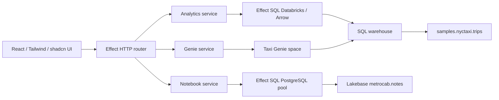

# Data services

`src/main.ts` assembles the live service layers once. Routes capture the services
at construction; no request creates a new runtime or database pool. Shared domain
schemas live in `src/domain.ts`, and the frontend decodes responses using them.

## Analytics

The existing `effect-sql-databricks` package remains the transport. Application
queries use its tagged templates, named parameter markers, Arrow decoding, and
Effect `SqlSchema`. Sorting uses a closed set of SQL fragments. The offset is an
explicit `INT` parameter because Databricks rejects a BIGINT offset even for zero.
Dates are real calendar dates, the end date is inclusive, and ZIPs are five digits.

The overview cache has 64 keys, a 60-second success TTL, and zero failure TTL.
Concurrent requests for the same filters share one lookup. The four aggregates
run with concurrency three. Metadata is cached for five minutes. Trip pages have
25 rows and include the exact matching row count. Ordering includes the source
columns for stable pagination; identical duplicate source rows remain identical.

The SQL adapter cancels in-progress statements on interruption/deadline and scopes
all Arrow downloads. Internal SQL errors are logged on the server; client errors
contain safe operational guidance. No credentials or signed download URLs are
returned to the frontend. In the deployed Apps environment, Databricks rewrites
signed download URLs to its internal `http://storage-proxy.databricks.com` host.
The adapter has an explicit, exact-host opt-in for this runtime, enabled only when
`DATABRICKS_APP_NAME` is present. Workspace API requests retain HTTPS, and download
requests never inherit workspace credentials or cookies.

## Workspace authentication

`Workspace` shares one credential provider across SQL, Genie, and Lakebase.
Local development uses `databricks auth token` with the configured profile (or the
CLI's unified authentication defaults), cached briefly. Databricks Apps uses its
injected OAuth client ID/secret, requests `all-apis`, and refreshes before expiry
with a semaphore protecting concurrent refreshes. A supplied PAT is an optional
local alternative. All secrets are redacted and server-side.

Workspace API requests are interruptible and deadline-bound. Submissions are not
automatically retried: a missing response can represent a completed operation.
The HTTP server uses app identity access. Per-viewer Databricks user authorization
is a separate extension; the current notebook is intentionally shared.

## Genie

The bundle creates a classic conversational Genie space from
`config/taxi.geniespace.json`. The service starts conversations, posts follow-ups,
polls messages with a three-minute deadline, and fetches query attachment results.
The frontend keeps the conversation ID while its page is open, renders bounded
result previews, and exposes the generated SQL. Date/ZIP filters are appended
explicitly to each question. A new conversation clears the local history.

## Lakebase

The bundle declares a project, its existing production branch, and primary
endpoint. App resource permissions create the app's OAuth database identity. The
setup script runs the explicit migration as the deployer and grants the app
`USAGE` on `metrocab` and CRUD on `metrocab.notes`.

`@effect/sql-pg` supplies the scoped pool. The password Effect generates a fresh
Lakebase credential for each new physical connection. TLS certificate validation
is enabled; the pool uses the direct endpoint host, at most four connections,
15-second statement and connection deadlines, a 20-second acquisition deadline,
30-second idle timeout, and 45-minute connection lifetime. Workspace OAuth tokens
are never used directly as database passwords.

Migration is an idempotent transaction guarded by a PostgreSQL advisory lock.
App startup never creates schemas. UUID-keyed upserts make repeating a note save
safe; insert/update is a single SQL statement, including the saved filters.
The UI supports list/create/edit/pin/delete and reopening saved dashboard views.

## Deployment verification and workspace constraints

`npm run workspace:setup -- TARGET` reconciles infrastructure, initializes the
schema and app grants, and starts the app. `npm run data:check` checks actual live
services, reconciles all trip aggregations, verifies filtered/sorted rows, performs
temporary-note CRUD, and checks a grounded Genie answer plus a follow-up.
`npm run test:e2e` verifies actual browser interactions and persistence across reloads.
`node scripts/check-deployed.mjs dev` exercises the deployed HTTP APIs with an
authenticated caller while data access uses the app service principal.

The platform supplies a workspace hostname in this workspace, so the settings
boundary normalizes it to an HTTPS origin. The deployed proxy returned 502 for
the HTTP/2-only listener; the app uses HTTP/1.1 here. Both transports remain
covered by the local smoke check.

The verified workspace's free tier rejects additional warehouses with
`429 RESOURCE_EXHAUSTED` (limit 1), and rejects editing existing warehouses. The
bundle therefore adopts the existing starter warehouse and uses its exact name
and empty tags, without development-mode name/tag presets. SQL warehouse creation
is fully declared for workspaces that permit it. Lakebase is fixed at 1 CU with a
300-second suspension timeout on this tier; endpoint suspension settings cannot
be changed, so the endpoint inherits the project's defaults.

The tested premise was that this workspace accepted standard paid-workspace
compute settings. Direct raw API checks disproved it: extra warehouse creation
remained rejected after stopping the starter warehouse, while a project update to
its actual 1-CU settings succeeded. Inspect `databricks bundle plan -t dev` to
confirm an adopted warehouse requires no API update before deploying.

## References

- [SQL Statement Execution](https://docs.databricks.com/aws/en/dev-tools/sql-execution-tutorial)
- [Genie conversation API](https://docs.databricks.com/aws/en/genie/conversation-api)
- [Lakebase app authentication](https://docs.databricks.com/aws/en/oltp/projects/tutorial-databricks-apps-autoscaling)
- [Lakebase bundles](https://docs.databricks.com/aws/en/oltp/projects/manage-with-bundles)
- [Bundle resources](https://docs.databricks.com/aws/en/dev-tools/bundles/resources)
