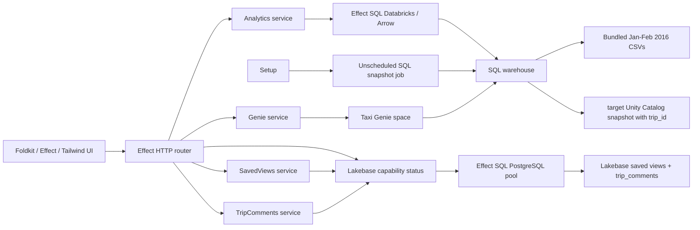

# Data services

`src/main.ts` assembles the live service layers once. Routes capture the services
at construction; no request creates a new runtime. `Lakebase` initializes one
shared database pool on first use and retries failed discovery on later requests.
`SavedViews` and `TripComments` are independent feature services using that pool.
Shared domain schemas live in `shared/domain.ts`, and the frontend decodes
responses using them.

`/api/status` retains the warehouse, Genie, and Lakebase configuration flags and
reports `capabilities` separately. Each is `unconfigured`, `unknown` (configured
but not yet exercised), `available`, or `unavailable`, based on the last operation
outcome. Status never probes dependencies. A Lakebase discovery outage affects
saved-view and trip-comment requests only; analytics, static assets, and health remain available.
Invalid workspace origins and PostgreSQL ports fail at the settings boundary.

## Analytics

The existing `effect-sql-databricks` package remains the transport. Application
queries use its tagged templates, named parameter markers, Arrow decoding, and
Effect `SqlSchema`. Sorting uses a closed set of SQL fragments. The offset is an
explicit `INT` parameter because Databricks rejects a BIGINT offset even for zero.
Dates are real calendar dates, the end date is inclusive, and ZIPs are five digits.

The overview cache has 64 keys, a 60-second success TTL, and zero failure TTL.
Concurrent requests for the same filters share one lookup. The four aggregates
run with concurrency three. Metadata is cached for five minutes. Trip pages have
25 rows and include the exact matching row count. Ordering includes the source
columns for stable pagination; identical duplicate source rows remain identical.

Setup uploads `jobs/nyc-zcta.jsonl` to the target's managed `taxi_sources` volume,
then runs the unscheduled `seed_trip_snapshot` SQL notebook on the existing warehouse.
The explicit CSV schema retains all 19 original fields from the January–February
2016 archive. `trips_2016_raw` stores all 22,288,907 records, source filename,
persisted UUID `trip_id`, and quality flags. Timestamps use `TIMESTAMP_NTZ` to
preserve the source's New York local wall-clock times.

The accepted `trips_2016` table contains 22,145,892 rows. Its policy requires
pickup in [2016-01-01,2016-03-01), positive finite fare and distance, and duration
in (0,24 hours]. Invalid source records stay in raw. GPS validity uses a broad
NYC-region bounding box: longitude [-75,-72], latitude [40,42]. Missing or invalid
GPS does not exclude an otherwise valid trip from counts or fare revenue.
`trip_quality_2016` reports raw, accepted, rejected and missing-GPS counts per file.

`taxi_zip_cells_2016` stores pinned Census 2020 ZCTA geometry as WKB and a grid of
candidate cells. `trip_locations_2016` tests distinct, unrounded GPS endpoints
against those polygons with `ST_Covers`; shared boundaries choose the lowest ZIP
for a deterministic single label. Unmatched locations retain NULL ZIPs. These
labels are geographic approximations, not recorded postal addresses or 2016 ZIP
boundaries. `scripts/prepare-zcta.mjs` regenerates the pinned boundary artifact
from NYC Open Data; changing boundaries or cleaning policy requires a new table
version rather than silently changing an existing snapshot.

The pipeline uses `CREATE TABLE IF NOT EXISTS` for each materialized step, so a
retry resumes from existing tables and preserves IDs. Validation reconciles the
accepted count with raw quality flags and checks unique, non-null IDs. The app
principal receives catalog/schema usage and SELECT on the accepted table and
quality-summary view.
`data_catalog` (default `workspace`) and `data_schema` (default `${var.data_name}`)
control the job, app, source volume and Genie dataset. The old `trips` demo and
its existing comments remain intact; new dataset rows have their own identities.

`npm run data:prepare -- TARGET` runs the same notebook statements through the SQL
API on an existing target, uploads boundaries, cancels an interrupted in-progress
statement, and saves `.databricks/taxi-ingestion-report.json`. It prepares data
without changing the running app. Normal setup writes `.env` only after the seed
succeeds, then migrates Lakebase and starts the app. The SQL task has a one-hour
timeout and no schedule. `test/workspace-setup.test.ts` verifies that failures
stop setup before app startup and preserve the previous local configuration.

Warehouse trip rows decode enriched details from SQL JSON through the shared
`TripDetails` schema. API coordinates are either a complete validated endpoint or
NULL; the original values remain in raw and accepted Delta rows. Historical
Lakebase comment snapshots may omit details, while new warehouse trip rows
always include them. CSV export flattens endpoints and all additional source
fields; the inspector distinguishes metered fare from recorded total charges.

All metadata, overview, and trip statements share one per-process admission pool,
including distinct cache keys and trip pages. `WAREHOUSE_MAX_CONCURRENCY` defaults
to four. A permit covers submission, polling, result download, and decoding; cache
hits use no permit. The 90-second admission deadline includes queue time.
Cancelled or expired waiters never submit SQL, and permits remain held through
interruption cleanup. These limits apply to each app process, not other apps or
external warehouse clients.

The SQL adapter cancels in-progress statements on interruption/deadline and scopes
all Arrow downloads. Internal SQL errors are logged on the server; client errors
contain safe operational guidance. No credentials or signed download URLs are
returned to the frontend. In the deployed Apps environment, Databricks rewrites
signed download URLs to its internal `http://storage-proxy.databricks.com` host.
The adapter has an explicit, exact-host opt-in for this runtime, enabled only when
`DATABRICKS_APP_NAME` is present. Workspace API requests retain HTTPS, and download
requests never inherit workspace credentials or cookies.

## Workspace authentication

`Workspace` shares one credential provider across SQL, Genie, and Lakebase.
Local development uses `databricks auth token` with the configured profile (or the
CLI's unified authentication defaults), cached briefly. Databricks Apps uses its
injected OAuth client ID/secret, requests `all-apis`, and refreshes before expiry
with a semaphore protecting concurrent refreshes. A supplied PAT is an optional
local alternative. All secrets are redacted and server-side.

Workspace API requests are interruptible and deadline-bound. Submissions are not
automatically retried: a missing response can represent a completed operation.
The HTTP server uses app identity access. Per-viewer Databricks user authorization
is a separate extension; saved views and trip comments are intentionally shared.

## GPS activity

`GET /api/gps-activity` accepts the shared pickup date/ZIP filters and a pickup
or dropoff endpoint. The warehouse groups original coordinates into H3
resolution-10 cells and returns their native boundaries, exact trip counts,
average fare/distance, and common ZIP area. Dropoff mode retains pickup filters.
Invalid endpoints are excluded from geometry but remain in matching-trip totals.

The response reports matching, located and shown trips, total cell count, and
truncation. Up to 100,000 busiest cells are returned; a bounded response must
display its partial coverage. Successful results are cached for five minutes
across 16 filter/endpoint keys. Reads use the same warehouse admission pool as
other analytics; failed results are not retained in the cache.

Request identities reject obsolete filter/endpoint responses. Frame identities
also include the selected cell, so readiness tracks the actual rendered state.
The scoped lazy renderer keeps its camera across updates and releases the map,
GPU overlay, popup and observers on navigation. Areas can be selected on the map
or through keyboard-accessible ranked buttons. Genie receives endpoint, coverage
and selected-cell statistics, without the full geometry payload.

## Genie

The bundle creates a classic conversational Genie space from
the `serialized_space` definition in `databricks.yml`. The service starts conversations, posts follow-ups,
exposes message status, and fetches query attachment results.
Submission (`POST /api/genie`) returns conversation and message IDs without
waiting for an answer. Status polling (`GET
/api/genie/:conversationId/messages/:messageId`) and result retrieval (`GET
/api/genie/:conversationId/messages/:messageId/result`) are independent reads.
The frontend bounds each polling attempt to three minutes; result retrieval also
has a three-minute server deadline. A timed-out attempt can be resumed by ID.

Ask Genie opens a contextual helper over the current page. Desktop users can
continue interacting with the page or expand the helper for wider query results;
mobile uses a modal sheet. Chart actions select a specific visualization, while
the page action includes the overview, visible trip records and their sort/page,
or the GPS map's endpoint, selected area and coverage. Applied filters are shown before sending.
Changing the page, filters, chart metric, or trip pagination invalidates a chart
selection. Closing and reopening the helper keeps the draft and current selection.

`GenieInput.context` carries a page, title, and optional JSON snapshot bounded to
24,000 characters. The server labels this as client-provided context rather than
instructions. Additional analytics query the source table with the current
filters; visible records and ranked subsets are not treated as the full dataset.
The Genie definition is embedded in the bundle so catalog/schema substitutions
resolve before deployment. Its data source and server-side prompt use the same
configured `trips_2016` table as app analytics.
Each saved turn retains its own filters and context alongside the answer.
The floating helper preserves the existing chart widths and page position.

`GENIE_MAX_CONCURRENCY` independently limits concurrent submission requests to two
by default. The 30-second submission deadline includes admission waiting. Polling
and result retrieval do not consume submission permits, and a permit is released
when submission returns IDs rather than when the conversation finishes. Neither
initial questions nor follow-ups are automatically replayed after a timeout.
Both concurrency settings must be positive integers; invalid values fail startup.

The frontend saves the question, IDs, recovery stage, and completed answers in
`sessionStorage`, validates that history on reload, and resumes outstanding reads.
The layout owns polling, which continues across navigation and while the helper
is closed. A failed result download exposes a download retry that never
submits the question again. Submission responses continue to be saved while
navigating within the app. A reload that loses a submission response explicitly
reports an uncertain submission and never automatically resubmits it. Recovery
lasts for the current browser tab's session; closing the tab discards it.

Validation and explicit upstream rejections are saved as rejected submissions,
with an action to edit the question before manually submitting again. Timeouts,
connection failures, server failures, and invalid acceptance responses retain the
uncertain-submission warning. Reloading either state never replays the question.

The frontend renders bounded result previews and exposes the generated SQL.
Date/ZIP filters are appended explicitly to each question. A new conversation
clears the saved history.

## Service errors

Services return a discriminated `ServiceError` union. The HTTP boundary alone
maps validation, missing saved views, dependency failures, timeouts, upstream response
errors, and unavailable Genie messages to status codes and safe error bodies.
Original causes stay on server-side errors and are logged at the boundary.
Unexpected defects remain defects and are handled as internal server errors;
interruption remains interruption.

The browser adapts declared errors to `ApiRequestError`, preserving their code,
message, and optional upstream HTTP status. Consumers can distinguish validation,
conflicts, and dependency failures without parsing messages. Upstream response
bodies and diagnostic causes remain server-side.

The PostgreSQL password callback must be infallible. `src/pg-credentials.ts`
bridges that constraint using a private, recognizable defect and restores only
that credential failure to the typed channel at database-query and migration
boundaries. SQL and row-decoding errors retain their diagnostics. Unrelated
defects and interruption, including mixed causes, pass through the adapter.

## Lakebase

`src/lakebase.ts` owns endpoint discovery, fresh credentials, the scoped pool,
and observed availability. `Lakebase.use` runs a feature operation against its
shared SQL client without exposing initialization or retry policy to the feature.
`src/saved-views.ts` owns saved-view queries and conflicts;
`src/trip-comments.ts` owns comment queries and idempotent submissions. Each
service depends only on `Lakebase`, so either can be used without the other.
The feature uses `SavedView` schemas, `/api/saved-views` endpoints, and the
`metrocab.saved_views` table. A saved view contains filters and an optional finding;
the finding is its `body` field, not a separate entity.

`src/migrations.ts` exports `migrateAppSchema` for the application's tables,
indexes, and grants. `scripts/migrate.ts` owns CLI environment handling and invokes
it with a scoped client from `makeLakebaseClient`. Application startup never
imports or executes migrations.

`npm run db:migrate` creates the current schema in a transaction guarded by an
advisory lock. Setup runs it before starting the app; re-running it preserves
existing rows.

The bundle declares a project, its existing production branch, and primary
endpoint. App resource permissions create the app's OAuth database identity. The
bundle's `notebook_project`, `notebook_branch`, and `notebook_endpoint` keys are
historical deployment-state identities retained to keep existing resources;
display names use saved views. Databricks SQL notebook jobs are a separate
platform concept and retain their platform terminology.
The setup script runs the explicit migration as the deployer and grants the app
`USAGE` on `metrocab`, CRUD on `metrocab.saved_views`, and SELECT/INSERT/UPDATE on
`metrocab.trip_comments` (UPDATE supports idempotent submission, not editing).

`@effect/sql-pg` supplies the scoped pool. The password Effect generates a fresh
Lakebase credential for each new physical connection. TLS certificate validation
is enabled; the pool uses the direct endpoint host, at most four connections,
15-second statement and connection deadlines, a 20-second acquisition deadline,
30-second idle timeout, and 45-minute connection lifetime. Workspace OAuth tokens
are never used directly as database passwords.

Migration is an idempotent transaction guarded by a PostgreSQL advisory lock.
App startup never creates schemas. UUID-keyed creates reject duplicates, and
updates require the current version; each write is a single SQL statement,
including the saved filters. The UI supports list/create/edit/pin/delete and
reopening saved dashboard views.

`GET /api/saved-views` returns `{ rows, nextCursor }` with at most 24 saved views per page.
The optional `cursor` query parameter is the JSON-encoded continuation object;
the shared HTTP contract handles encoding and validation. Pages order by pinned
status, update time, and UUID, all descending. Cursors retain PostgreSQL's full
timestamp precision and remain usable if the boundary saved view is deleted. The
explicit migration adds the matching listing index. The Saved views chooser's
**Load more views** action appends pages, retains visible views if a later request
fails, and offers a retry. Saves, pins, and deletes refresh the loaded pages.

`GET /api/trip-comments` accepts a JSON-encoded `trip` snapshot and optional
`cursor`, decoded by the shared Effect HTTP contract. It returns up to 25 comments
and a continuation cursor, newest first; ordering and cursors use full PostgreSQL
timestamp precision. `POST /api/trip-comments` accepts `{ id, trip, body }`. The
server resolves the author from the same viewer identity as `/api/me`; it never
accepts an author from the submitted payload. Unknown viewers are labeled as
workspace viewers, and the existing shared app-access model applies.

Trip comments and saved views share `Lakebase`'s scoped pool, lazy discovery,
capability reporting, typed errors, and explicit application migration. Each thread keys
to the persisted `trip_id`, independent of filtering, sorting, page position, or
other trip fields. The stored trip is client-supplied context, not a verified
warehouse foreign key; enforce record access at the API boundary when adapting
this template to user-specific records. The warehouse snapshot remains read-only.

A comment UUID belongs to one draft. Repeating an identical submission returns
the original comment; reusing the ID with different text, trip ID, or author fails.
Client-created view, comment, and Genie turn IDs share `client/src/lib/uuid.ts`,
which creates UUID v4 IDs with `crypto.getRandomValues`. This also works on HTTP
origins where `crypto.randomUUID` is unavailable. Browser tests remove
`randomUUID` and exercise all three creation flows.
Reads and retries retain the originally stored trip context even if other fields
in the submitted snapshot change.
Comments are append-only through the API. The inspector retains drafts while
closing/reopening or inspecting other records on the current filtered page;
filter changes, navigation, and reload discard unsent drafts. Failed writes keep
the text and ID for an explicit retry. Older pages remain readable after a failed
continuation request. `test/trip-comments.test.ts` runs the production migration
and queries against embedded Postgres; the browser suite verifies the actual
inspector, retry, attribution display, and desktop/mobile layouts.
`npm run data:check:comments` also verifies a real warehouse trip and Lakebase
round trips with the configured development migration/deployer role, then removes
its UUID-scoped temporary comments even when an assertion fails.

## Contextual workflows

The UX separates two user intentions: keep an analysis worth returning to, and
discuss a specific record. Saving and discussing both start beside the data.
**Save view** captures the applied filters with a name and optional finding;
pending edits must be applied before saving is available. The current view's
chooser opens the existing shared library beside the filters. Choosing a row
applies that view's filters to the current Explore page and replaces any draft,
including when the applied URL already matches. Paginated browsing, pinning,
editing, and deletion stay in the chooser. Existing saved views and optimistic edit
versions are preserved. The generic panel and chooser accept caller-provided
controls and summaries; the taxi feature owns its date/ZIP definitions.

Trip timestamps and explicit comment actions open a focused inspector with the
route, timestamps, fare, distance, duration, and shared discussion. The responsive
sheet keeps the desktop table visible behind it and uses the full mobile width;
keyboard dismissal restores focus to the selected record. Saving a view and
posting a comment demonstrate separate Lakebase writes alongside warehouse reads
and contextual Genie analysis, using the same typed Effect API boundaries.

## Deployment verification and workspace constraints

`npm run workspace:setup -- TARGET` reconciles infrastructure, initializes the
schema and app grants, and starts the app. `npm run data:check` checks actual live
services, reconciles all trip aggregations, verifies filtered/sorted rows, performs
temporary-view CRUD, and checks a grounded Genie answer plus a follow-up.
`npm run test:e2e` verifies actual browser interactions and persistence across reloads.
`node scripts/check-deployed.mjs dev` exercises the deployed HTTP APIs with an
authenticated caller while data access uses the app service principal.
CI and deployment prechecks install Chromium and require `npm run test:browser`
after the build and service checks. This offline suite covers saved-view pagination
and conflicts, filter validation, Genie recovery, and responsive interactions.
The deployment workflow waits for `RUNNING`, then requires the deployed API check
to succeed; a healthy process with broken data access fails the deployment job.
The verifier follows saved-view continuation cursors and removes its temporary saved view
even if reading it back fails.

The platform supplies a workspace hostname in this workspace, so the settings
boundary normalizes it to an HTTPS origin. The app uses an HTTP/1.1 server,
covered by the local smoke check.

The verified workspace's free tier rejects additional warehouses with
`429 RESOURCE_EXHAUSTED` (limit 1), and rejects editing existing warehouses. The
bundle therefore adopts the existing starter warehouse and uses its exact name
and empty tags, without development-mode name/tag presets. SQL warehouse creation
is fully declared for workspaces that permit it. Lakebase is fixed at 1 CU with a
300-second suspension timeout on this tier; endpoint suspension settings cannot
be changed, so the endpoint inherits the project's defaults.

The tested premise was that this workspace accepted standard paid-workspace
compute settings. Direct raw API checks disproved it: extra warehouse creation
remained rejected after stopping the starter warehouse, while a project update to
its actual 1-CU settings succeeded. Inspect `databricks bundle plan -t dev` to
confirm an adopted warehouse requires no API update before deploying.

## References

- [SQL Statement Execution](https://docs.databricks.com/aws/en/dev-tools/sql-execution-tutorial)
- [Genie conversation API](https://docs.databricks.com/aws/en/genie/conversation-api)
- [Lakebase app authentication](https://docs.databricks.com/aws/en/oltp/projects/tutorial-databricks-apps-autoscaling)
- [Lakebase bundles](https://docs.databricks.com/aws/en/oltp/projects/manage-with-bundles)
- [Bundle resources](https://docs.databricks.com/aws/en/dev-tools/bundles/resources)
