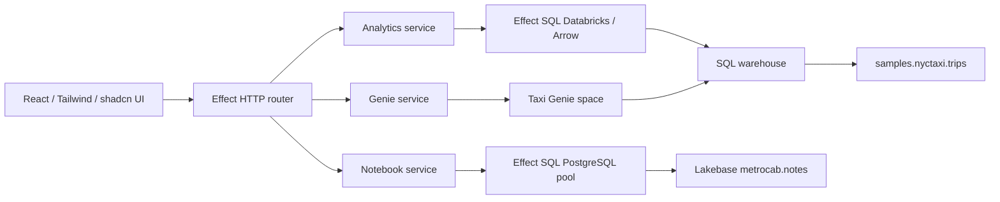

# Data services

`src/main.ts` assembles the live service layers once. Routes capture the services
at construction; no request creates a new runtime. The notebook initializes one
shared database pool on first use and retries failed discovery on later requests. Shared domain
schemas live in `src/domain.ts`, and the frontend decodes responses using them.

`/api/status` retains the warehouse, Genie, and Lakebase configuration flags and
reports `capabilities` separately. Each is `unconfigured`, `unknown` (configured
but not yet exercised), `available`, or `unavailable`, based on the last operation
outcome. Status never probes dependencies. A Lakebase discovery outage affects
notebook requests only; analytics, static assets, and health remain available.
Invalid workspace origins and PostgreSQL ports fail at the settings boundary.

## Analytics

The existing `effect-sql-databricks` package remains the transport. Application
queries use its tagged templates, named parameter markers, Arrow decoding, and
Effect `SqlSchema`. Sorting uses a closed set of SQL fragments. The offset is an
explicit `INT` parameter because Databricks rejects a BIGINT offset even for zero.
Dates are real calendar dates, the end date is inclusive, and ZIPs are five digits.

The overview cache has 64 keys, a 60-second success TTL, and zero failure TTL.
Concurrent requests for the same filters share one lookup. The four aggregates
run with concurrency three. Metadata is cached for five minutes. Trip pages have
25 rows and include the exact matching row count. Ordering includes the source
columns for stable pagination; identical duplicate source rows remain identical.

All metadata, overview, and trip statements share one per-process admission pool,
including distinct cache keys and trip pages. `WAREHOUSE_MAX_CONCURRENCY` defaults
to four. A permit covers submission, polling, result download, and decoding; cache
hits use no permit. The 90-second admission deadline includes queue time.
Cancelled or expired waiters never submit SQL, and permits remain held through
interruption cleanup. These limits apply to each app process, not other apps or
external warehouse clients.

The SQL adapter cancels in-progress statements on interruption/deadline and scopes
all Arrow downloads. Internal SQL errors are logged on the server; client errors
contain safe operational guidance. No credentials or signed download URLs are
returned to the frontend. In the deployed Apps environment, Databricks rewrites
signed download URLs to its internal `http://storage-proxy.databricks.com` host.
The adapter has an explicit, exact-host opt-in for this runtime, enabled only when
`DATABRICKS_APP_NAME` is present. Workspace API requests retain HTTPS, and download
requests never inherit workspace credentials or cookies.

## Workspace authentication

`Workspace` shares one credential provider across SQL, Genie, and Lakebase.
Local development uses `databricks auth token` with the configured profile (or the
CLI's unified authentication defaults), cached briefly. Databricks Apps uses its
injected OAuth client ID/secret, requests `all-apis`, and refreshes before expiry
with a semaphore protecting concurrent refreshes. A supplied PAT is an optional
local alternative. All secrets are redacted and server-side.

Workspace API requests are interruptible and deadline-bound. Submissions are not
automatically retried: a missing response can represent a completed operation.
The HTTP server uses app identity access. Per-viewer Databricks user authorization
is a separate extension; the current notebook is intentionally shared.

## Genie

The bundle creates a classic conversational Genie space from
`config/taxi.geniespace.json`. The service starts conversations, posts follow-ups,
exposes message status, and fetches query attachment results.
Submission (`POST /api/genie`) returns conversation and message IDs without
waiting for an answer. Status polling (`GET
/api/genie/:conversationId/messages/:messageId`) and result retrieval (`GET
/api/genie/:conversationId/messages/:messageId/result`) are independent reads.
The frontend bounds each polling attempt to three minutes; result retrieval also
has a three-minute server deadline. A timed-out attempt can be resumed by ID.

`GENIE_MAX_CONCURRENCY` independently limits concurrent submission requests to two
by default. The 30-second submission deadline includes admission waiting. Polling
and result retrieval do not consume submission permits, and a permit is released
when submission returns IDs rather than when the conversation finishes. Neither
initial questions nor follow-ups are automatically replayed after a timeout.
Both concurrency settings must be positive integers; invalid values fail startup.

The frontend saves the question, IDs, recovery stage, and completed answers in
`sessionStorage`, validates that history on reload, and resumes outstanding reads
after navigation. A failed result download exposes a download retry that never
submits the question again. Submission responses continue to be saved while
navigating within the app. A reload that loses a submission response explicitly
reports an uncertain submission and never automatically resubmits it. Recovery
lasts for the current browser tab's session; closing the tab discards it.

Validation and explicit upstream rejections are saved as rejected submissions,
with an action to edit the question before manually submitting again. Timeouts,
connection failures, server failures, and invalid acceptance responses retain the
uncertain-submission warning. Reloading either state never replays the question.

The frontend renders bounded result previews and exposes the generated SQL.
Date/ZIP filters are appended explicitly to each question. A new conversation
clears the saved history.

## Service errors

Services return a discriminated `ServiceError` union. The HTTP boundary alone
maps validation, missing notes, dependency failures, timeouts, upstream response
errors, and unavailable Genie messages to status codes and safe error bodies.
Original causes stay on server-side errors and are logged at the boundary.
Unexpected defects remain defects and are handled as internal server errors;
interruption remains interruption.

The browser adapts declared errors to `ApiRequestError`, preserving their code,
message, and optional upstream HTTP status. Consumers can distinguish validation,
conflicts, and dependency failures without parsing messages. Upstream response
bodies and diagnostic causes remain server-side.

The PostgreSQL password callback must be infallible. `src/pg-credentials.ts`
bridges that constraint using a private, recognizable defect and restores only
that credential failure to the typed channel at notebook and migration
boundaries. SQL and row-decoding errors retain their diagnostics. Unrelated
defects and interruption, including mixed causes, pass through the adapter.

## Lakebase

The bundle declares a project, its existing production branch, and primary
endpoint. App resource permissions create the app's OAuth database identity. The
setup script runs the explicit migration as the deployer and grants the app
`USAGE` on `metrocab` and CRUD on `metrocab.notes`.

`@effect/sql-pg` supplies the scoped pool. The password Effect generates a fresh
Lakebase credential for each new physical connection. TLS certificate validation
is enabled; the pool uses the direct endpoint host, at most four connections,
15-second statement and connection deadlines, a 20-second acquisition deadline,
30-second idle timeout, and 45-minute connection lifetime. Workspace OAuth tokens
are never used directly as database passwords.

Migration is an idempotent transaction guarded by a PostgreSQL advisory lock.
App startup never creates schemas. UUID-keyed creates reject duplicates, and
updates require the current version; each write is a single SQL statement,
including the saved filters. The UI supports list/create/edit/pin/delete and
reopening saved dashboard views.

`GET /api/notes` returns `{ rows, nextCursor }` with at most 24 notes per page.
The optional `cursor` query parameter is the JSON-encoded continuation object;
the shared HTTP contract handles encoding and validation. Pages order by pinned
status, update time, and UUID, all descending. Cursors retain PostgreSQL's full
timestamp precision and remain usable if the boundary note is deleted. The
explicit migration adds the matching listing index. The notebook's **Load more
notes** action appends pages, retains visible notes if a later request fails,
and offers a retry. Saves, pins, and deletes refresh the loaded pages.

## Deployment verification and workspace constraints

`npm run workspace:setup -- TARGET` reconciles infrastructure, initializes the
schema and app grants, and starts the app. `npm run data:check` checks actual live
services, reconciles all trip aggregations, verifies filtered/sorted rows, performs
temporary-note CRUD, and checks a grounded Genie answer plus a follow-up.
`npm run test:e2e` verifies actual browser interactions and persistence across reloads.
`node scripts/check-deployed.mjs dev` exercises the deployed HTTP APIs with an
authenticated caller while data access uses the app service principal.
CI and deployment prechecks install Chromium and require `npm run test:browser`
after the build and service checks. This offline suite covers notebook pagination
and conflicts, filter validation, Genie recovery, and responsive interactions.
The deployment workflow waits for `RUNNING`, then requires the deployed API check
to succeed; a healthy process with broken data access fails the deployment job.
The verifier follows notebook continuation cursors and removes its temporary note
even if reading it back fails.

The platform supplies a workspace hostname in this workspace, so the settings
boundary normalizes it to an HTTPS origin. The deployed proxy returned 502 for
the HTTP/2-only listener; the app uses HTTP/1.1 here. Both transports remain
covered by the local smoke check.

The verified workspace's free tier rejects additional warehouses with
`429 RESOURCE_EXHAUSTED` (limit 1), and rejects editing existing warehouses. The
bundle therefore adopts the existing starter warehouse and uses its exact name
and empty tags, without development-mode name/tag presets. SQL warehouse creation
is fully declared for workspaces that permit it. Lakebase is fixed at 1 CU with a
300-second suspension timeout on this tier; endpoint suspension settings cannot
be changed, so the endpoint inherits the project's defaults.

The tested premise was that this workspace accepted standard paid-workspace
compute settings. Direct raw API checks disproved it: extra warehouse creation
remained rejected after stopping the starter warehouse, while a project update to
its actual 1-CU settings succeeded. Inspect `databricks bundle plan -t dev` to
confirm an adopted warehouse requires no API update before deploying.

## References

- [SQL Statement Execution](https://docs.databricks.com/aws/en/dev-tools/sql-execution-tutorial)
- [Genie conversation API](https://docs.databricks.com/aws/en/genie/conversation-api)
- [Lakebase app authentication](https://docs.databricks.com/aws/en/oltp/projects/tutorial-databricks-apps-autoscaling)
- [Lakebase bundles](https://docs.databricks.com/aws/en/oltp/projects/manage-with-bundles)
- [Bundle resources](https://docs.databricks.com/aws/en/dev-tools/bundles/resources)
